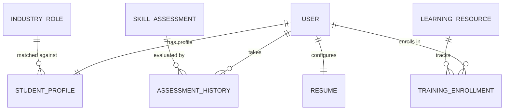

# 🗄️ CareerSync Database Architecture & Schema Design
**Author:** Vikas Yadav  
**Role:** Database Architecture & Core Student/Skill Backend Developer  
**Project:** CareerSync Integrated Campus Placement Platform  

---

## 1. Architecture Overview
CareerSync uses MongoDB as its primary operational data store, structured through Mongoose ODM with strict validation, modular subdocuments, and compound indexing for high query throughput.

---

## 2. Core Collections & Schemas

### 2.1 `StudentProfile`
- **Primary Owner:** Vikas Yadav
- **Storage Pattern:** Single document with embedded sub-schemas for optimal read performance on dashboard views.
- **Subdocuments:**
  - `education`: Academic history (degree, institution, GPA/percentage, verification status).
  - `skills`: Categorized competencies with verification badges and proficiency scores.
  - `projects`: Technical projects with tech stack arrays and repository links.
  - `certifications`: External credentials with verification flags.
  - `experience`: Internships and work history.
  - `achievements`: Contests, hackathons, and publications.
  - `placementStatus`: Current placement cycle state (`Seeking Opportunities`, `Interviewing`, `Placed`).

### 2.2 `SkillAssessment` & `AssessmentHistory`
- **Assessment Collection:** Stores author-defined MCQs, difficulty tiers, time limits, and passing thresholds.
- **Anti-Cheat Optimization:** Questions served to students exclude `correctOptionIndex` and `explanation`.
- **History Collection:** Implements immutable attempt logging. On passing, triggers an automated update to `StudentProfile.skills` awarding a verifiable skill badge.

### 2.3 `LearningResource` & `TrainingEnrollment`
- **Learning Resources:** Courses, workshops, hackathons, and bootcamps linked to specific `skillsCovered` tags.
- **Enrollment Tracking:** Unique compound index `{ student: 1, resource: 1 }` prevents duplicate registrations while tracking progress ($0-100\%$).
- **Completion Hook:** When progress reaches $100\%$, automated sync adds a verified credential to the student profile.

### 2.4 `IndustryRole` & Matching Engine
- Standardized competency benchmarks with weighted skill requirements (1–5) and mandatory tags.
- Enables the Skill-Gap Analysis engine to calculate readiness scores ($0-100\%$) and suggest tailored learning resources.

### 2.5 `Resume`
- ATS-compliant formatting configuration storing templates (`modern`, `classic`, `minimal`, `executive`), section visibility toggles, and real-time ATS scoring.

---

## 3. Performance Indexing Strategy

| Collection | Indexed Fields | Type | Purpose |
| :--- | :--- | :--- | :--- |
| `studentprofiles` | `{ user: 1 }` | Unique | 1-to-1 link with User account |
| `studentprofiles` | `{ 'academicInfo.department': 1, 'academicInfo.graduationYear': 1 }` | Compound | Fast student filtering for TPOs |
| `studentprofiles` | `{ 'placementStatus.status': 1, 'academicInfo.cgpa': -1 }` | Compound | Recruiter candidate sorting by CGPA |
| `studentprofiles` | `{ 'skills.name': 1 }` | Multikey | Skill-based talent search |
| `skillassessments` | `{ skillName: 1, difficulty: 1, isActive: 1 }` | Compound | Quick test retrieval by skill |
| `assessmenthistories`| `{ student: 1, assessment: 1 }` | Compound | Student attempt lookups |
| `learningresources`| `{ type: 1, difficulty: 1, isActive: 1 }` | Compound | Filtered catalog exploration |
| `trainingenrollments`| `{ student: 1, resource: 1 }` | Unique Compound | Duplicate enrollment prevention |
| `resumes` | `{ 'publicShare.shareSlug': 1 }` | Sparse Unique | Public portfolio URL resolution |

---

## 4. Resilience & Fallback Handling
- **Database Fallback:** The backend connection logic (`config/db.js`) includes automated fallback from MongoDB Atlas to a local MongoDB instance (`127.0.0.1:27017/careersync`) whenever dynamic IP whitelisting or external network access is blocked.
